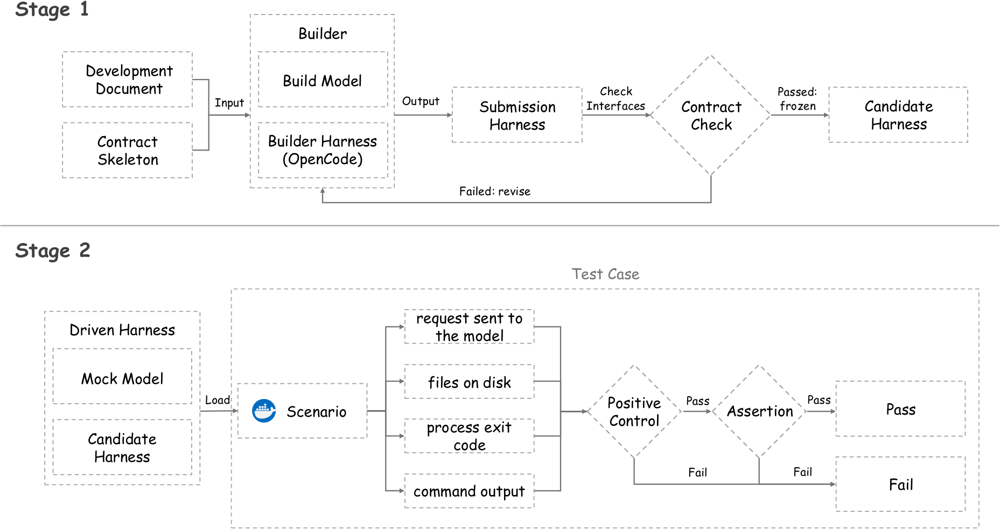
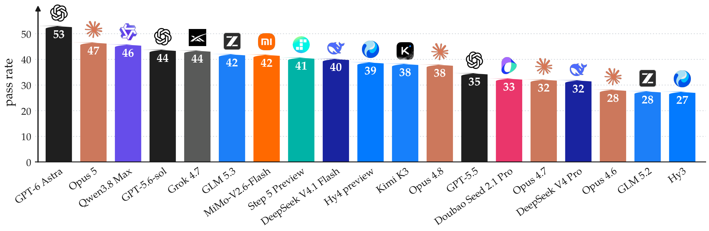

<p align="center">
  <a href="https://geyuyao.com/doc2harness/"></a>
</p>

<h3 align="center">Benchmarking LLMs on Long-Horizon Harness Engineering of Coding Agents</h3>

<p align="center">
  <a href="https://geyuyao.com/doc2harness/"></a>
  <a href="https://arxiv.org/abs/2610.20344"></a>
  <a href="LICENSE"></a>
  
  
  
  <a href="https://github.com/users/YuyaoGe/packages/container/package/doc2harness-builder"></a>
</p>

<p align="center">
  <a href="https://geyuyao.com/doc2harness/">🌐 Website</a> •
  <a href="https://arxiv.org/abs/2610.20344">📄 Paper</a> •
  <a href="#-quick-start">⚡ Quick start</a> •
  <a href="#-scenario-catalog">🧪 Scenarios</a> •
  <a href="#-leaderboard">🏆 Leaderboard</a> •
  <a href="#-citation">📝 Citation</a>
</p>

---

Doc2Harness measures how well a model can **build a working coding agent** —
the harness itself — rather than how well it writes a patch inside one.

- 🏗️ **Stage 1 — Build.** A build model, working through
  [OpenCode](https://github.com/anomalyco/opencode) in an isolated container,
  receives a development document and an interface-only skeleton and has to
  implement a complete agent harness.
- 🔬 **Stage 2 — Evaluate.** The harness is frozen, moved to a separate
  container, and driven end to end by a scripted **mock model**. Each scenario
  reads four observable channels — requests sent to the model, files on disk,
  exit code, command output — and **positive controls** rule out vacuous passes.

<p align="center">
  <a href="https://geyuyao.com/doc2harness/"></a>
</p>

> [!NOTE]
> 📦 **This is a partial open-source release.** The full benchmark in the paper
> has **328 test cases**; this repository releases a subset of **94 scenarios**
> (53 scored test cases plus the 41 positive controls that gate them). The
> remaining test cases are held out. Numbers on the leaderboard below come from
> the full suite and cannot be reproduced from this subset alone.

## 🏆 Leaderboard

<p align="center">
  <a href="https://geyuyao.com/doc2harness/"></a>
</p>

Pass rate of **19 frontier models** on the full 328-case suite, strongest on the
left. Each model built **three independent harnesses**; a bar is their mean.
The best model reaches **53.05%** and the weakest **27.44%** — even the
strongest still fails nearly half the cases. See the
[project page](https://geyuyao.com/doc2harness/) for per-category breakdowns
and case studies.

## ⚡ Quick start

**Requirements:** Python 3.11+ and Docker. No third-party Python packages —
both stages are standard library only.

### 1️⃣ Score an existing harness (Stage 2 only)

No model key needed: scenarios drive the product against a mock gateway.

```bash
# build the evaluation image once (see containers/README.md for mirror options)
docker build --target evaluation -t doc2harness/evaluation:candidate -f containers/Dockerfile .

# run all 94 scenarios against a product directory (one containing src/yuyao/)
PYTHONPATH=src:tools:run python3 tools/run_production_catalog.py \
  --artifact /path/to/product --artifact-id my-product \
  --output /tmp/scores --concurrency 12 --timeout 300
```

- Narrow the selection with `--family headless` or `--scenario-id <id>`.
- Output: one JSON receipt per scenario plus `catalog_receipt.json`. The
  score is `pass / (pass + fail)` over applicable scenarios; a scenario that
  cannot be observed on a product is `INCONCLUSIVE`, not a failure.
- The full catalog takes about 25–90 seconds at concurrency 12.

### 2️⃣ Build a new harness (Stage 1), then score it

Needs the builder image and a local [LiteLLM](https://github.com/BerriAI/litellm)
gateway holding **your** API key — setup in
[`src/stage1/README.md`](src/stage1/README.md).

```bash
docker pull ghcr.io/yuyaoge/doc2harness-builder:latest

# free: prints the full orchestration plan, starts nothing, needs no key
PYTHONPATH=src python3 src/stage1/run_build.py --builder-tag <model> --dry-run

# the real build (~15 minutes)
PYTHONPATH=src python3 src/stage1/run_build.py --builder-tag <model> --out-dir results/

# then score results/<run_id>/agent with step 1️⃣
```

### ✅ Sanity check

```bash
PYTHONPATH=src python3 -c "from doc2harness.benchmark.dispatch import active_scenario_ids as a; print(len(a()))"
# 94
```

Loading the catalog also verifies its digests, so an edited or inconsistent
catalog fails here instead of silently scoring a different set.

## 🧪 Scenario catalog

| Family | Total | Scored | Controls | What it observes |
|---|--:|--:|--:|---|
| 📄 `file` | 17 | 9 | 8 | Read / edit / patch tools, including hostile encodings |
| 🔒 `permission` | 16 | 8 | 8 | Whether permission rules really constrain spawned processes |
| 💾 `state` | 14 | 7 | 7 | Slash commands and session state |
| 🤖 `headless` | 13 | 6 | 7 | Non-interactive runs and contract entry points |
| 🔌 `direct` | 11 | 6 | 5 | Wire-level model protocol against a mock gateway |
| 🖥️ `tui` | 9 | 5 | 4 | Interactive terminal behaviour over a real pty |
| 📦 `artifact` | 7 | 7 | 0 | Product shape: entry point, launcher, lockfile, wheels |
| 🚀 `startup` | 5 | 4 | 1 | Install and launch, ambient-environment isolation |
| 🧩 `extension` | 2 | 1 | 1 | Extension points that must not fire without their trigger |
| **Total** | **94** | **53** | **41** | |

Each scenario is one file:
`src/doc2harness/benchmark/harnesses/<family>/scenarios/<scenario_id>.py`.

**Controls are not scored and are not free passes.** A control proves that the
command *can* succeed when nothing blocks it, so a blocked run reads as "the
rule held" rather than "the command never worked". Each scored scenario
declares its controls in `definition.dependencies`; if you narrow the selection,
keep it closed under those dependencies.

## 📁 Repository layout

```text
src/doc2harness/   Stage 2 evaluation framework: catalog, drivers, mock gateway
src/stage1/        Stage 1 build pipeline: spec, skeleton, builder image, smoke layers
tools/             run_production_catalog.py — score a product
run/               YAML-driven launchers
containers/        evaluation image
assets/            figures for this README
```

## 📝 Citation

If you find Doc2Harness useful, please cite the
[paper](https://arxiv.org/abs/2610.20344):

```bibtex
@article{ge2026doc2harness,
  title   = {Doc2Harness: Benchmarking LLMs on Long-Horizon Harness Engineering of Coding Agents},
  author  = {Ge, Yuyao and Liu, Shenghua and Gao, Peizhong and Ge, Chendi and Liu, Chenxu and
             Wang, Yiwei and Mei, Lingrui and Bi, Baolong and Yao, Jiayu and Guo, Jiafeng and
             Cheng, Xueqi},
  journal = {arXiv preprint arXiv:2610.20344},
  year    = {2026}
}
```

## 🙏 Acknowledgments

The product skeleton derives from the project layout of
**[mini-swe-agent](https://github.com/SWE-agent/mini-swe-agent)** (MIT).
Builds run through **[OpenCode](https://github.com/anomalyco/opencode)**, and
the model gateway is **[LiteLLM](https://github.com/BerriAI/litellm)**. We
thank their authors and contributors.

Licensed under [Apache 2.0](LICENSE); see [`NOTICE`](NOTICE) for upstream
attribution.
